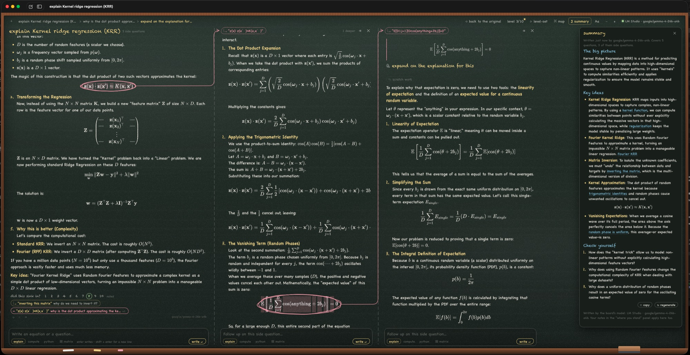

# Equation Explainer

A macOS blackboard for digging into mathematics and quantum algorithms with an LLM.

You write an equation or a question. The explanation is chalked onto the board step by step.
**Highlight any part of it** (a phrase, a whole equation or just a piece of one) and ask a side
question. The answer opens **to the right**, connected to what you circled. Inside that answer you can
highlight again and drill deeper. When you're done, close the side columns (`Esc`, the ✕, the
breadcrumb, or the eraser on the chalk ledge) and you're back at the original equation. Every board
is saved with all of its branches, and the circled spots stay marked so you can reopen any branch later.



## Features

- **Lateral drill-down.** Each side question is a column anchored to the exact text or formula you
  highlighted. Columns chain to any depth, with a breadcrumb and a *board map* to jump between levels.
- **Real math.** KaTeX renders LaTeX, matrices (`pmatrix`, `bmatrix`, …) and Dirac notation
  (`\ket`, `\bra`, `\braket`). The **▦ matrix** helper builds matrices with presets (I, X, Y, Z, H, S, T, CNOT).
- **It learns where you stand.**
  - Under every answer, a poll asks "did this sink in?" from 1 to 10. Unrated answers count as 1.
  - The **level-set** pass reads every question and rating across all boards and builds a learner
    profile: an overall level, plus mastery per topic. It runs on OpenRouter with
    `openai/gpt-5.6-sol-pro`, by itself whenever you start a new board, and on demand from
    **⟳ level-set** (⇧⌘L).
  - Each explanation's system prompt includes the profile plus everything asked since the last
    level-set, with its rating, so a rating counts on the very next question.
  - Recap scales with the score. 1–3 gets a condensed, higher-level refresher, 4–6 a brief reminder,
    7–8 a name-check, and 9–10 is treated as known.
  - **level n/10** (⌥⌘L) opens the *where you stand* panel. It shows your level, tutoring needs and
    topic mastery, plus exactly what the model is told about you (the learner part of the system
    prompt, with the base tutoring rules underneath).
  - **My notes**, in the same panel, are your own directions, for example "show me the Bloch-sphere
    picture before the algebra". Every note goes into the system prompt of
    each explanation and outranks the profile and the recap rules; a newer note beats an older one.
    The level-set reads them too, and a new note marks the profile for reassessment.
- **Board summary.** **∑ summary** (⇧⌘S) writes a short, high-level recap of the board to reinforce
  what you learned. It covers the main question, its follow-ups and every side question, however deep.
  - Each key idea links back to the questions where it came up. A click opens that column and lights up
    the question; any side question the model forgot to link is listed under *also explored*.
  - It ends with two or three *check yourself* questions. Ideas you rated low get a little more room,
    and your notes apply here too.
  - The summary is saved inside the board. **↻ regenerate** writes a new one, and the old one stays
    until the new one is finished. A dot on the button means you have asked more since.
  - It is written by the board's model (`LLM_PROVIDER`).
- **Diagrams.** Wherever an answer involves a circuit or an architecture, it draws one in chalk, right
  where it helps.
  - Quantum circuits (and reversible ones) are drawn on wires, with gates, controls, ⊕ targets, swaps,
    measurements, barriers and labelled stages such as *oracle* and *diffusion*.
  - Architectures, pipelines, feedback loops and logic circuits are drawn as block diagrams, with grouped
    layers and dashed skip connections. Labels can hold math.
  - The answer only says what to draw. A separate model, `qwen/qwen3-coder-30b-a3b-instruct` on
    OpenRouter (`DIAGRAM_MODEL`), turns that into the diagram, and the app lays it out. A diagram takes a few
    seconds and costs a fraction of a cent.
  - **◇** under any answer asks for a diagram of it. On a diagram, **⤢** enlarges it, **↻** redraws it (the
    old one stays until the new one is ready) and **✕** erases it. Diagrams are saved with the board.
- **No code unless you ask.** Answers stick to mathematics. Code appears only when your question asks
  for code, Python, a script or a plot, or when you use *compute* mode.
- **Computation.**
  - *compute* mode makes the model write a runnable Python block for your calculation.
  - *python* mode runs your own code.
  - Every Python block has **▶ Execute**. It runs in the background in a separate process with numpy,
    sympy, scipy, matplotlib and the `boardkit` helpers (gates, kets, `kron`, `qft`,
    `grover_diffusion`, `probs`, `show()`).
  - Results render as math, and figures render as images. Failed runs get **fix it ↻**.
- **Zoom.** Use ⌘= and ⌘−, or pinch. Click ⤢ on any displayed equation for a magnifying lens.
- **Chalk look.** Slate texture, a wooden frame and handwritten fonts (Chalkboard SE, Chalkduster,
  Bradley Hand, Noteworthy, Marker Felt). Switch fonts with **Aa**.

## Setup

```bash
cp .env.example .env      # then pick a provider
make run                  # builds "build/Equation Explainer.app" and opens it
```

`.env` is re-read on every request, so edits apply immediately. **Board ▸ Open .env** opens it.

| key | meaning |
| --- | --- |
| `LLM_PROVIDER` | `lmstudio` or `openrouter` (inferred from `OPENROUTER_API_KEY` if unset) |
| `LMSTUDIO_BASE_URL` / `LMSTUDIO_MODEL` | default `http://localhost:1234/v1`; a blank model means whatever LM Studio has loaded |
| `OPENROUTER_API_KEY` / `OPENROUTER_MODEL` | default model `anthropic/claude-fable-5.1` |
| `LLM_TEMPERATURE`, `LLM_MAX_TOKENS`, `LLM_EXTRA_BODY` | generation settings (`LLM_EXTRA_BODY` is JSON merged into the request) |
| `LEVELSET_MODEL` | model for the level-set, default `openai/gpt-5.6-sol-pro` on OpenRouter (needs `OPENROUTER_API_KEY`) |
| `LEVELSET_PROVIDER`, `LEVELSET_MAX_TOKENS`, `LEVELSET_EXTRA_BODY` | where the level-set runs (`openrouter` by default, or `lmstudio`) and its request settings |
| `DIAGRAM_MODEL` | model that draws diagrams, default `qwen/qwen3-coder-30b-a3b-instruct` on OpenRouter (needs `OPENROUTER_API_KEY`; without it, answers come without diagrams) |
| `DIAGRAM_PROVIDER`, `DIAGRAM_TEMPERATURE`, `DIAGRAM_MAX_TOKENS`, `DIAGRAM_EXTRA_BODY` | where diagrams are drawn (`openrouter` by default, or `lmstudio`) and their request settings |
| `PYTHON_PATH` | use your own interpreter instead of the managed environment |
| `PYTHON_PACKAGES`, `PYTHON_TIMEOUT` | packages for the managed environment, and the per-run time limit in seconds |

The first ▶ Execute creates a managed virtualenv in `~/Library/Application Support/EquationExplainer/pyenv`.
This takes about a minute and happens only once. Boards are JSON files in
`~/Library/Application Support/EquationExplainer/Boards` (**Board ▸ Reveal Boards Folder**).
The learner profile (`learner.json`) and your notes (`learner-notes.json`) sit next to that folder. Both are
written owner-only (0600), never live in the repository, and are git-ignored as a safety net.

## Keys

| | |
| --- | --- |
| highlight text, then pick a question | open a side question to the right |
| click a circled or underlined spot | reopen or close its side question |
| `Esc` or `⌘[` | close the rightmost side question |
| `⇧⌘⌫` | back to the original (close all) |
| `⇧⌘M` / `⌥⌘M` | board map / insert matrix |
| `⇧⌘S` | board summary |
| `⇧⌘L` / `⌥⌘L` | level-set now / where you stand and my notes (`⌘Enter` saves a note) |
| `Enter` / `Shift+Enter` | write / new line (`⌘Enter` runs in python mode) |

## Development

```bash
make test       # Swift unit tests (config, SSE parsing, storage, python runner)
make dev        # same UI in a browser at http://127.0.0.1:5178 with a Node bridge
make selftest   # drives the real app end to end against your LLM and saves snapshots to /tmp/ee-selftest
```

Layout:

- `Sources/EECore` holds the testable core: `.env` and config, the streaming client, the Python runner and board storage.
- `Sources/EquationExplainer` is the SwiftUI shell, the WKWebView host and the JS bridge.
- `App/Web` is the blackboard UI in plain JS, with vendored KaTeX, marked, DOMPurify, highlight.js and dagre (diagram layout).
- `App/Python` holds the cell runner, `boardkit` and the matplotlib chalk style.

## License

Licensed under either of

- Apache License, Version 2.0 ([LICENSE-APACHE](LICENSE-APACHE) or <https://www.apache.org/licenses/LICENSE-2.0>)
- MIT license ([LICENSE-MIT](LICENSE-MIT) or <https://opensource.org/licenses/MIT>)

at your option.

Unless you explicitly state otherwise, any contribution intentionally submitted for inclusion in this
project by you, as defined in the Apache-2.0 license, shall be dual licensed as above, without any
additional terms or conditions.

The vendored libraries in `App/Web/vendor` keep their own licenses: KaTeX, marked and dagre (MIT),
DOMPurify (Apache-2.0 or MPL-2.0) and highlight.js (BSD-3-Clause).
