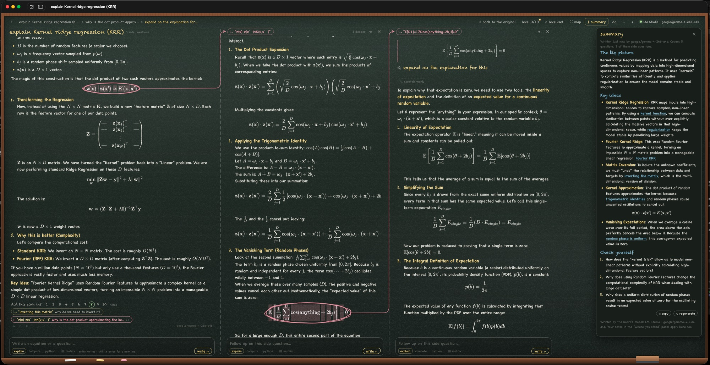

# Equation Explainer

A desktop blackboard (macOS and Linux) for digging into mathematics and quantum algorithms with an LLM.

You write an equation or a question. The explanation is chalked onto the board step by step.
**Highlight any part of it** (a phrase, a whole equation or just a piece of one) and ask a side
question. The answer opens **to the right**, connected to what you circled. Inside that answer you can
highlight again and drill deeper. When you're done, close the side columns (`Esc`, the ✕, the
breadcrumb, or the eraser on the chalk ledge) and you're back at the original equation. Every board
is saved with all of its branches, and the circled spots stay marked so you can reopen any branch later.
You can also **read a PDF paper** on the board and highlight its passages the same way.



## Features

- **Lateral drill-down.** Each side question is a column anchored to the exact text or formula you
  highlighted. Columns chain to any depth, with a breadcrumb and a *board map* to jump between levels.
- **Read a paper.** **▤ paper** (⌘O), or dropping a PDF on the board, opens it in the first column.
  - Highlight any passage, a sentence or a formula, and ask about it. The answer opens to the right, circled and
    connected to the spot on the page, and you can drill deeper from there as usual. The question chips change to
    suit a paper (*explain this passage*, *what does this notation mean?*, *how does this fit into the rest of
    the paper?*).
  - The bar under the paper asks about the paper as a whole.
  - The model is given the paper's text: the highlighted page, the pages around it and the first page (title and
    abstract), or the paper from the start for whole-paper questions. It is told to rebuild formulas that come out
    of the PDF garbled, and to keep to the paper's notation.
  - The paper is chalked onto the slate; **☐ paper** switches to black on white. Pages are drawn as you scroll.
  - The PDF is copied into the Boards folder (`Boards/papers`), so the board keeps working if the original moves.
    Opening the same file again goes back to its board. The board summary covers the side questions about the paper.
  - Rendering is Mozilla's pdf.js.
- **Read a paper paragraph by paragraph.** **¶ read** (⇧⌘P), above or under the paper, starts a guided reading.
  - The model takes one paragraph at a time. It opens to the right and explains the paragraph in more detail and
    in easier terms: the point first, then each idea unpacked (symbols defined, skipped steps filled in, formulas
    written out properly), and how it follows from what came before.
  - Ask about the paragraph in that column for as long as you like, then **next paragraph →** (⌥⌘]) moves on.
    **← previous** (⌥⌘[) goes back. A paragraph already read opens as it was, without asking again.
  - The paragraph being read is bracketed on the page; those already read keep a faint wash. Highlighting a
    passage offers *read on from here*.
  - Paragraphs are found from the layout of the PDF's text: blank space, indented first lines, short last lines
    and changes of type size. Headings join the paragraph they open, formulas stay with their paragraph, and
    running heads and page numbers are left out. A paragraph that runs over a page break is read whole and
    marked on both pages, also when a figure or table at the top of the next page sits between its two halves.
  - The place you got to is saved with the board. Each paragraph read counts as a side question, so the summary,
    the lessons learned and the recap include them.
- **Confidential boards: LM Studio only.** **🔓** in the top bar (⌥⌘P, or **Board ▸ Confidential Board**) locks
  the board you are on; **🔒 local only** unlocks it again. You can lock a fresh board before its first question.
  - Everything the board asks goes to LM Studio on this computer: explanations, side questions, summary, lessons,
    recap, diagrams and the paper reader. The model menu lists only LM Studio models while you are on it, and a pick
    there is kept apart from the one your other boards use. If `.env` names no LM Studio model, the board uses LM
    Studio's defaults (`http://localhost:1234/v1`, whatever model is loaded).
  - The app itself enforces it, not only the page: a confidential request that names any other model is answered
    by LM Studio, and the level-set model is refused unless it is LM Studio.
  - Its questions stay on the board. The level-set leaves it out, and other boards' prompts do not mention it.
  - The flag is saved with the board and shown as 🔒 in the board list. Locking a board stops any answer still
    coming from another model. "Local" means the address in `LMSTUDIO_BASE_URL`; keep it on this machine.
- **Real math.** KaTeX renders LaTeX, matrices (`pmatrix`, `bmatrix`, …) and Dirac notation
  (`\ket`, `\bra`, `\braket`). The **▦ matrix** helper builds matrices with presets (I, X, Y, Z, H, S, T, CNOT).
- **It learns where you stand.**
  - Under every answer, a poll asks "did this sink in?" from 1 to 10. Unrated answers count as 1.
  - The **level-set** pass reads every question and rating across all boards and builds a learner
    profile: an overall level, plus mastery per topic. It runs on OpenRouter with
    `openai/gpt-5.6-sol-pro`, by itself whenever you start a new board, and on demand from
    **⟳ level-set** (⇧⌘L).
  - Each explanation's system prompt includes the profile plus everything asked since the last
    level-set, with its rating, so a rating counts on the very next question.
  - Recap scales with the score. 1–3 gets a condensed, higher-level refresher, 4–6 a brief reminder,
    7–8 a name-check, and 9–10 is treated as known.
  - **level n/10** (⌥⌘L) opens the *where you stand* panel. It shows your level, tutoring needs and
    topic mastery, plus exactly what the model is told about you (the learner part of the system
    prompt, with the base tutoring rules underneath).
  - **My notes**, in the same panel, are your own directions, for example "show me the Bloch-sphere
    picture before the algebra". Every note goes into the system prompt of
    each explanation and outranks the profile and the recap rules; a newer note beats an older one.
    The level-set reads them too, and a new note marks the profile for reassessment.
- **Board summary.** **∑ summary** (⇧⌘S) writes a short, high-level recap of the board to reinforce
  what you learned. It covers the main question, its follow-ups and every side question, however deep.
  - Each key idea links back to the questions where it came up. A click opens that column and lights up
    the question; any side question the model forgot to link is listed under *also explored*.
  - It ends with two or three *check yourself* questions. Ideas you rated low get a little more room,
    and your notes apply here too.
  - The summary is saved inside the board. **↻ regenerate** writes a new one, and the old one stays
    until the new one is finished. A dot on the button means you have asked more since.
  - It is written by the board's model (`LLM_PROVIDER`).
- **Lessons learned.** **✎ lessons** (⇧⌘K) pops up the theory this board's answers have taught you:
  concepts, principles, theorems and why they hold, grouped by topic rather than by question. Derivation
  steps, worked numbers and code are left out.
  - It only updates when you have asked something new on the board. Opening it folds the newly answered
    questions in. If nothing is new, it just shows the lessons and no request is sent. A dot on the button
    means there is something to fold in.
  - The lessons are saved inside the board. **↻ rewrite from scratch** starts over from every question.
  - They are written by the board's model, and your notes apply.
- **Recap.** **❡ recap** (⇧⌘R) pops up a detailed write-up of everything the board taught you. It is a
  self-contained explanation of the topic that you can study from later, organised by the logic of the
  topic rather than the order of your questions.
  - It puts the weight on what did not sink in: answers you rated low, passages you asked side questions
    about (especially chains of "how did you get this?"), and topics where your level-set profile is weak.
    Those points are explained again step by step, with the skipped steps filled in, an example, and the
    likely misconception, under *Where it got tricky*.
  - It ends with the key formulas and a few exercises on what is still weakest. Links in the text jump
    back to the questions.
  - It is written the first time you open it and saved inside the board. After that it is shown as it is.
    **↻ regenerate** rewrites it with the model currently picked in the top bar, and the old one stays
    until the new one is finished. A dot on the button means you have asked more since.
- **Diagrams.** Wherever an answer involves a circuit or an architecture, it draws one in chalk, right
  where it helps.
  - Quantum circuits (and reversible ones) are drawn on wires, with gates, controls, ⊕ targets, swaps,
    measurements, barriers and labelled stages such as *oracle* and *diffusion*.
  - Architectures, pipelines, feedback loops and logic circuits are drawn as block diagrams, with grouped
    layers and dashed skip connections. Labels can hold math.
  - The answer only says what to draw. The same model that wrote it (the one picked in the top bar) then turns
    that into the diagram in a second request, and the app lays it out. If the reply cannot be drawn, it is asked
    once more with the reason; **↻** tries again.
  - **◇** under any answer asks for a diagram of it. On a diagram, **⤢** enlarges it, **↻** redraws it (the
    old one stays until the new one is ready) and **✕** erases it. Diagrams are saved with the board.
- **No code unless you ask.** Answers stick to mathematics. Code appears only when your question asks
  for code, Python, a script or a plot, or when you use *compute* mode.
- **Computation.**
  - *compute* mode makes the model write a runnable Python block for your calculation.
  - *python* mode runs your own code.
  - Every Python block has **▶ Execute**. It runs in the background in a separate process with numpy,
    sympy, scipy, matplotlib and the `boardkit` helpers (gates, kets, `kron`, `qft`,
    `grover_diffusion`, `probs`, `show()`).
  - Results render as math, and figures render as images. Failed runs get **fix it ↻**.
- **Zoom.** Use ⌘= and ⌘−, or pinch. Click ⤢ on any displayed equation for a magnifying lens.
- **Chalk look.** Slate texture, a wooden frame and handwritten fonts: on macOS the system faces (Chalkboard SE,
  Chalkduster, Bradley Hand, Noteworthy, Marker Felt), elsewhere OFL faces bundled in `shared/web/fonts` (Patrick
  Hand, Architects Daughter, Gloria Hallelujah, Shadows Into Light, Gochi Hand, Fredericka the Great). **Aa** at the top
  right picks the face and has a slider for the text size (also ⌘= / ⌘− / ⌘0, Ctrl on Linux).

## Setup

```bash
make run                  # creates .env from .env.example on the first run (put your key in it, see below)
                          # macOS: builds "build/Equation Explainer.app" and opens it
                          # Linux: installs missing GTK/WebKitGTK packages, checks WebKit's sandbox, starts the app
```

### macOS

Needs Xcode's command line tools (Swift 5.9, macOS 14). `make run` builds the app bundle and opens it;
`make mac-app` only builds it.

### Linux (Ubuntu 24.04 or any distribution with GTK 4, libadwaita 1.5 and WebKitGTK 6.0)

```bash
make run              # first run: apt-installs python3-gi gir1.2-gtk-4.0 gir1.2-adw-1 gir1.2-webkit-6.0 python3-venv
                      # bubblewrap if missing (sudo asks for your password), then starts the app
make linux-install    # adds it to the app grid for this user: launcher, icon and the chalk fonts
```

The Linux app is Python 3 (PyGObject) around the same blackboard UI, in a WebKitGTK view with a native
libadwaita board list; nothing is installed from PyPI. WebKit sandboxes its web process with bubblewrap,
which needs unprivileged user namespaces. Ubuntu 24.04 forbids those by default
(`kernel.apparmor_restrict_unprivileged_userns=1`), so the first `make run` explains that and, after your
yes, sets it to 0 with sudo, persisted in `/etc/sysctl.d/60-equation-explainer-userns.conf` so it survives
reboots. `make linux-setup` runs just the checks; `EE_SKIP_SETUP=1 make run` skips them.

### Configuration

`.env` is re-read on every request, so edits apply immediately. **Board ▸ Open .env** (the ☰ menu on Linux)
opens it.

**Switching models.** The menu at the top right lists every model `.env` names: `LLM_PROVIDER`'s model first
(the default), then those of any other provider `.env` configures (OpenRouter once `OPENROUTER_API_KEY` is set,
LM Studio once any `LMSTUDIO_*` key is, a custom server once `LLM_BASE_URL` is). The pick applies to the next question and summary, so if LM Studio is
busy you can send the next one to OpenRouter without waiting. It is remembered across launches. Add more models
with a named key such as `OPENROUTER_ALT_MODEL` (any `OPENROUTER_<name>_MODEL`, `LMSTUDIO_<name>_MODEL` or
`LLM_<name>_MODEL`) or with `OPENROUTER_MODELS` / `LMSTUDIO_MODELS` / `LLM_MODELS` (comma-separated). ⓘ beside it opens *Model & runtime*. The level-set
keeps its own model; diagrams are drawn by the model you picked. On a confidential board the menu shows only LM Studio models. **more models…** at the end of the menu opens the source panel: pick OpenRouter,
LM Studio or a custom endpoint and any model the server lists, and **use** writes `LLM_PROVIDER` and the model key
to `.env` as the new default (API keys and endpoints are still edited in the file).

| key | meaning |
| --- | --- |
| `LLM_PROVIDER` | `lmstudio` or `openrouter` (inferred from `OPENROUTER_API_KEY` if unset) |
| `LMSTUDIO_BASE_URL` / `LMSTUDIO_MODEL` | default `http://localhost:1234/v1`; a blank model means whatever LM Studio has loaded |
| `OPENROUTER_API_KEY` / `OPENROUTER_MODEL` | default model `anthropic/claude-fable-5.1` |
| `OPENROUTER_ALT_MODEL` (any `OPENROUTER_<name>_MODEL`, likewise `LMSTUDIO_…` / `LLM_…`) | one more model for the top-right menu |
| `OPENROUTER_MODELS`, `LMSTUDIO_MODELS`, `LLM_MODELS` | extra models for the top-right menu, comma-separated |
| `LLM_TEMPERATURE`, `LLM_MAX_TOKENS`, `LLM_EXTRA_BODY` | generation settings (`LLM_EXTRA_BODY` is JSON merged into the request) |
| `LEVELSET_MODEL` | model for the level-set, default `openai/gpt-5.6-sol-pro` on OpenRouter (needs `OPENROUTER_API_KEY`) |
| `LEVELSET_PROVIDER`, `LEVELSET_MAX_TOKENS`, `LEVELSET_EXTRA_BODY` | where the level-set runs (`openrouter` by default, or `lmstudio`) and its request settings |
| `PYTHON_PATH` | use your own interpreter instead of the managed environment |
| `PYTHON_PACKAGES`, `PYTHON_TIMEOUT` | packages for the managed environment, and the per-run time limit in seconds |

To run everything on OpenRouter (explanations, summaries, diagrams and the level-set), set
`LLM_PROVIDER=openrouter` and `OPENROUTER_API_KEY`; the board summary is written by the board's model.

### Where things live

| | macOS | Linux |
| --- | --- | --- |
| boards (one JSON file each) | `~/Library/Application Support/EquationExplainer/Boards` | `~/.local/share/EquationExplainer/Boards` |
| PDF papers opened on boards | `Boards/papers` (one copy per file, named by its content) | same |
| learner profile and your notes | next to the Boards folder, written owner-only (0600) | same |
| managed Python environment | `…/EquationExplainer/pyenv` | `…/EquationExplainer/pyenv` |

`EE_DATA_DIR` moves the whole folder, `EE_BOARDS_DIR` only the boards, `EE_ENV_FILE` points at another
`.env`. The first ▶ Execute creates the managed virtualenv (about a minute, once). **Board ▸ Reveal Boards
Folder** opens the folder. The learner files never live in the repository and are git-ignored as a safety net.

## Keys

macOS uses ⌘, Linux uses Ctrl; the tooltips in the app show the right one.

| | macOS | Linux |
| --- | --- | --- |
| highlight text, then pick a question | opens a side question to the right | |
| click a circled or underlined spot | reopens or closes its side question | |
| close the rightmost side question | `Esc` or `⌘[` | `Esc` or `Ctrl+[` |
| back to the original (close all) | `⇧⌘⌫` | `Ctrl+Shift+Backspace` |
| board map / insert matrix | `⇧⌘M` / `⌥⌘M` | `Ctrl+Shift+M` / `Ctrl+Alt+M` |
| board summary / lessons learned / recap | `⇧⌘S` / `⇧⌘K` / `⇧⌘R` | `Ctrl+Shift+S` / `Ctrl+Shift+K` / `Ctrl+Shift+R` |
| level-set now / where you stand and my notes | `⇧⌘L` / `⌥⌘L` | `Ctrl+Shift+L` / `Ctrl+Alt+L` |
| new board / write on the board | `⌘N` / `⌘L` | `Ctrl+N` / `Ctrl+L` |
| read a PDF paper | `⌘O` (or drop a PDF on the board) | `Ctrl+O` |
| read it paragraph by paragraph / next / previous paragraph | `⇧⌘P` / `⌥⌘]` / `⌥⌘[` | `Ctrl+Shift+P` / `Ctrl+Alt+]` / `Ctrl+Alt+[` |
| confidential board (LM Studio only) on / off | `⌥⌘P` | `Ctrl+Alt+P` |
| zoom in / out / actual size | `⌘=` / `⌘−` / `⌘0` | `Ctrl+=` / `Ctrl+-` / `Ctrl+0` |
| write / new line | `Enter` / `Shift+Enter` (`⌘Enter` runs in python mode, saves a note) | same with `Ctrl+Enter` |

## Development

```bash
make test       # unit tests for this OS: Swift (macOS) or pytest (Linux): config, SSE parsing, streaming, storage, python runner
make dev        # same UI in a browser at http://127.0.0.1:5178 with a Node bridge
make selftest   # drives the real app end to end against your LLM and saves snapshots to /tmp/ee-selftest
                # (it reads built-in test papers; pass --selftest-pdf FILE to the app to use a real one)
make help       # every target, including the explicit mac-* and linux-* ones
```

Layout:

- `shared/web` is the blackboard UI in plain JS, used unchanged by both apps and the dev harness, with vendored
  KaTeX, marked, DOMPurify, highlight.js, dagre (diagram layout) and pdf.js (papers, with its standard fonts and
  CMaps), and the chalk fonts for non-Mac platforms.
- `shared/python` holds the cell runner, `boardkit` and the matplotlib chalk style.
- `macos/` is the Swift package: `Sources/EECore` (the testable core: `.env` and config, the streaming client,
  the Python runner, board storage), `Sources/EquationExplainer` (the SwiftUI shell, the WKWebView host and the
  JS bridge), `Tests/`, and `scripts/build_app.sh`, which assembles the `.app` at `build/`.
- `linux/` is the Python package `equation_explainer`: `config.py`, `llm.py`, `store.py` and `pyrunner.py` are
  the same core as `EECore`; `app.py` is the GTK4 / libadwaita shell, the WebKitGTK host and the JS bridge.
  `tests/` are pytest, `bin/equation-explainer` runs it from the tree, `data/` has the desktop entry and icon.
- `dev/devserver.mjs` serves the UI to a browser with the bridge over HTTP.

Both apps implement the same bridge: the page sends `{cmd, …}` messages (`config`, `chat`, `python`,
`saveBoard`, …) and receives streamed tokens through `EE.native.chunk/done/error`; the self test in
`shared/web/js/selftest.js` exercises all of it inside whichever app is running.

## License

Licensed under either of

- Apache License, Version 2.0 ([LICENSE-APACHE](LICENSE-APACHE) or <https://www.apache.org/licenses/LICENSE-2.0>)
- MIT license ([LICENSE-MIT](LICENSE-MIT) or <https://opensource.org/licenses/MIT>)

at your option.

Unless you explicitly state otherwise, any contribution intentionally submitted for inclusion in this
project by you, as defined in the Apache-2.0 license, shall be dual licensed as above, without any
additional terms or conditions.

The vendored libraries in `shared/web/vendor` keep their own licenses: KaTeX, marked and dagre (MIT),
DOMPurify (Apache-2.0 or MPL-2.0), highlight.js (BSD-3-Clause) and pdf.js (Apache-2.0, `vendor/pdfjs/LICENSE`). The fonts in `shared/web/fonts` are under the
SIL Open Font License 1.1 (their `OFL-*.txt` files sit next to them).
